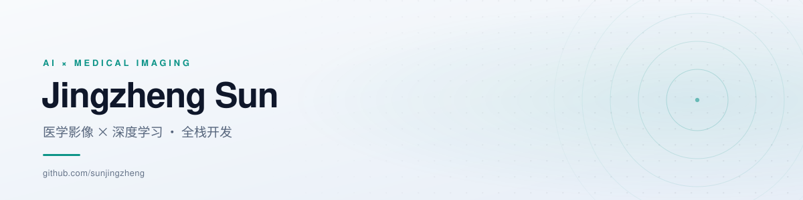

  <picture>
    <source media="(prefers-color-scheme: dark)" srcset="./assets/banner-dark.svg">
    
  </picture>

## 关于

用 AI 解决具体问题 —— 从医学影像的分割与重建，到景区里的数字人导游。

- **医学影像 AI**：论文复现与工程化。Synapse 多器官分割、PET 重建，在意的是可复现的评测口径，而不只是跑通脚本。
- **智能导览**：数字人讲解、语音合成与路线推荐。Vue 3 前端，Python 服务端，端到端自己搭。
- **AI 工具链**：把文献调研、实验、写作、配图这套科研流程，沉淀成可复用的 Skills。

## 精选项目

| 项目 | 做什么 | 技术栈 |
| :-- | :-- | :-- |
| [**aiguide**](https://github.com/sunjingzheng/aiguide) | AI 数字人景区导览：实时数字人驱动、语音讲解与智能路线推荐 | `Vue` `Python` `LiveTalking` |
| [**scenic-ai-guide-admin**](https://github.com/sunjingzheng/scenic-ai-guide-admin) | 导览系统运营后台：业务指标看板与内容配置 | `Vue 3` `TypeScript` `ECharts` |
| [**codex-academic-research-skills**](https://github.com/sunjingzheng/codex-academic-research-skills) | 科研 Skills 聚合安装器，把研究流程串成一条可复用的中文工作流 | `Shell` |
| **HAM-DCF 复现** | Synapse 分割 + PET 重构的论文复现，附评测口径与改进台账 | `PyTorch` `MONAI` |

更多见 [全部仓库](https://github.com/sunjingzheng?tab=repositories)

## 技术栈

**AI / 科研**

**前端**

**工程**

## GitHub

  <picture>
    <source media="(prefers-color-scheme: dark)" srcset="https://github-readme-stats.vercel.app/api?username=sunjingzheng&show_icons=true&hide_border=true&hide_rank=true&bg_color=00000000&title_color=2DD4BF&icon_color=2DD4BF&text_color=9AA9BF&locale=cn&hide=issues,prs,contribs&custom_title=%E5%85%AC%E5%BC%80%E6%95%B0%E6%8D%AE">
    
  </picture>
  <picture>
    <source media="(prefers-color-scheme: dark)" srcset="https://github-readme-stats.vercel.app/api/top-langs/?username=sunjingzheng&layout=compact&hide_border=true&bg_color=00000000&title_color=2DD4BF&text_color=9AA9BF&langs_count=6&hide=html,css,batchfile,powershell,dockerfile&locale=cn">
    
  </picture>

## 联系

